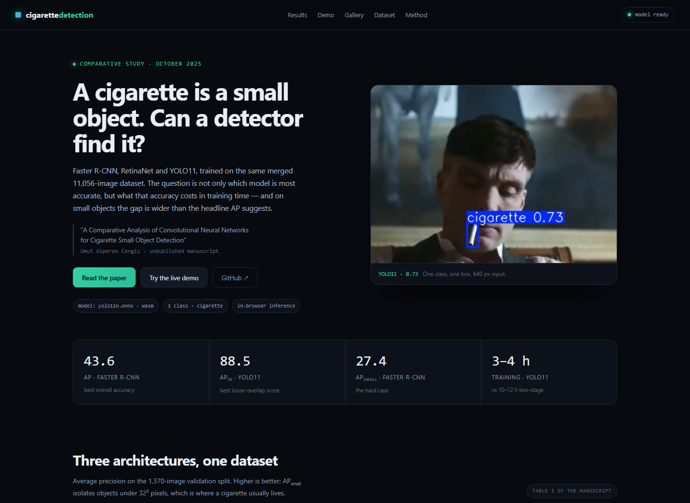

# Cigarette Small Object Detection

A comparative study of **Faster R-CNN**, **RetinaNet** and **YOLO11** on the same
cigarette-detection dataset — with a demo that runs the trained YOLO11 model **inside the
browser**, so there is no server and no upload.

**Live page:** <https://umutalperencengiz.github.io/cigarette-small-object-detection/>

> **Paper:** [A Comparative Analysis of Convolutional Neural Networks for Cigarette
> Small Object Detection](static/paper/SmallObjectDetectionPaper.pdf) · Umut Alperen Cengiz ·
> October 2025



## Results

Validation split: 1,370 images, single class `cigarette`. Values reproduced from Table 1
of the manuscript. The bundled checkpoint is the `train15` run whose predictions appear in
the paper's figures.

| Model | AP | AP<sub>50</sub> | AP<sub>75</sub> | AP<sub>s</sub> | AP<sub>m</sub> | AP<sub>l</sub> | Training |
| --- | ---: | ---: | ---: | ---: | ---: | ---: | ---: |
| **Faster R-CNN** (R50-FPN) | **43.64** | 87.25 | **38.95** | **27.41** | **45.07** | **51.75** | 10–12 h |
| RetinaNet (R50-FPN) | 41.76 | 84.67 | 35.70 | 24.30 | 43.36 | 51.23 | 8–10 h |
| YOLO11n | 40.40 | **88.50** | 35.20 | — | — | — | **3–4 h** |

**Takeaway.** Two-stage detection still wins on accuracy, and the margin grows as the IoU
threshold tightens. YOLO11 gives up ~3 AP overall but trains in roughly a third of the time
and has the best AP<sub>50</sub> — the trade-off the paper argues for.

## Demo

`index.html` is a static page. The YOLO11n checkpoint is shipped as a 10 MB ONNX graph and
executed by [ONNX Runtime Web](https://onnxruntime.ai/docs/tutorials/web/) (WebAssembly), so:

- **Image** — drop a file (or press *try a sample frame*); boxes, confidence and latency are
  shown over the annotated frame.
- **Video** — the clip stays local, frames are sampled at the chosen rate, and the result
  plays back with a box overlay plus a hit timeline and merged events. Export-to-MP4 is not
  done in the browser; the original clip is annotated as it plays.
- **Camera** — `getUserMedia` feed with a live overlay, confidence meter and sparkline.
  Browsers only expose the camera on HTTPS or `localhost`; the GitHub Pages URL is HTTPS.

No frame ever leaves the page: there is no API, no upload endpoint and no inference server.
Only the ONNX Runtime script and WASM binary come from jsDelivr; the model itself is served
from the same GitHub Pages origin.

### How it works

1. `static/app.js` letterboxes the frame to 640×640 (grey `114` padding), converts it to
   CHW float32 and runs the ONNX session.
2. The `[1, 5, 8400]` output is decoded (`cx, cy, w, h` plus one class score), thresholded and
   passed through class-agnostic NMS in JavaScript.
3. Boxes are mapped back through the letterbox transform and drawn on a canvas (camera,
   video) or baked into an annotated JPEG data URL (image).
4. GitHub Pages cannot send `COOP`/`COEP` headers, so the engine runs single-threaded WASM.
   That is roughly a few frames per second on a laptop CPU — enough for a live signal, not
   for 30 fps video.

The ONNX graph matches the PyTorch weights: on the bundled sample frame both return the same
box at 0.73 / 0.74 confidence.

Only YOLO11 is bundled. The Faster R-CNN (322 MB) and RetinaNet (296 MB) checkpoints were
trained for CUDA and are not included; their published predictions are shown in the page
gallery instead.

## Run locally

Any static file server works — no build step, no dependencies:

```bash
python -m http.server 8000
```

Open <http://localhost:8000>. Camera access works on `localhost`; opening the file directly
(`file://`) does not.

## Project layout

```
cigarette-small-object-detection/
├── index.html                 study page + demo
├── static/
│   ├── app.js                 charts, demo tabs, ONNX inference, camera + video loops
│   ├── style.css
│   ├── img/                   figures reproduced from the paper
│   ├── paper/                 manuscript PDF
│   └── samples/               sample frame + 6 s clip used by the demo buttons
├── models/
│   ├── cigarette_yolo11n.pt   YOLO11n checkpoint (5.2 MB)
│   └── cigarette_yolo11n.onnx browser export, 640×640 (10.1 MB)
├── tools/export_onnx.py       regenerate the ONNX graph
└── docs/preview.png
```

## Dataset

Three public Roboflow sets, merged into one class and cleaned of false annotations:

| Source | Link |
| --- | --- |
| Smoking Detection — Lppro | <https://universe.roboflow.com/lppro/smoking-detection-yg80w> |
| Cigarette — PhoneDT | <https://universe.roboflow.com/phonedt/cigarette-bkjaq> |
| Smoke Detection — ENSAM | <https://universe.roboflow.com/ensam-swz2h/smoke-detection-88ggt> |

Split after merging: **11,056** train / **1,370** validation / **1,868** test images.
The test split was used for qualitative checks only.

## Training setup

| | Faster R-CNN & RetinaNet | YOLO11n |
| --- | --- | --- |
| Framework | Detectron2 | Ultralytics |
| Config | `faster_rcnn_R_50_FPN_1x` / `retinanet_R_50_FPN_1x` | `yolo11n.pt` |
| Schedule | 35,000 iterations (~25 epochs) | 80 epochs, early stop at 72 |
| Batch | 4 × 2 grad-accum | 16 |
| Optimizer | Adam, 1e-3, AMP | Adam, 1e-4 |
| Input | — | 640 × 640 |
| Hardware | RTX 3060 6 GB | RTX 3060 6 GB |

Reproducing the Detectron2 rows requires Detectron2 and the two ~300 MB checkpoints,
which are not in this repository. The training scripts are kept in the paper repository.

## Related work

This is a standalone object-detection study. It is **not** part of the IR video anomaly
detection capstone; the two projects happen to share a workspace, not a pipeline.

## Ethics

Research and education only. The model detects a single narrow class, performs no identity
recognition and no tracking. Do not deploy it on people without consent.
